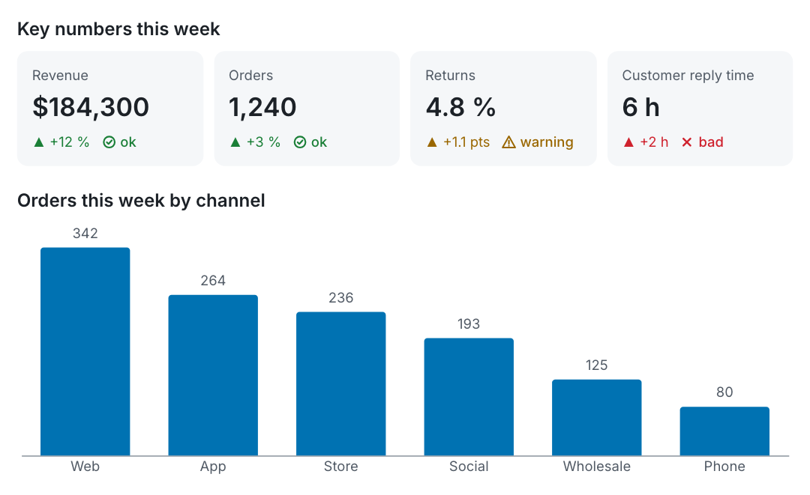
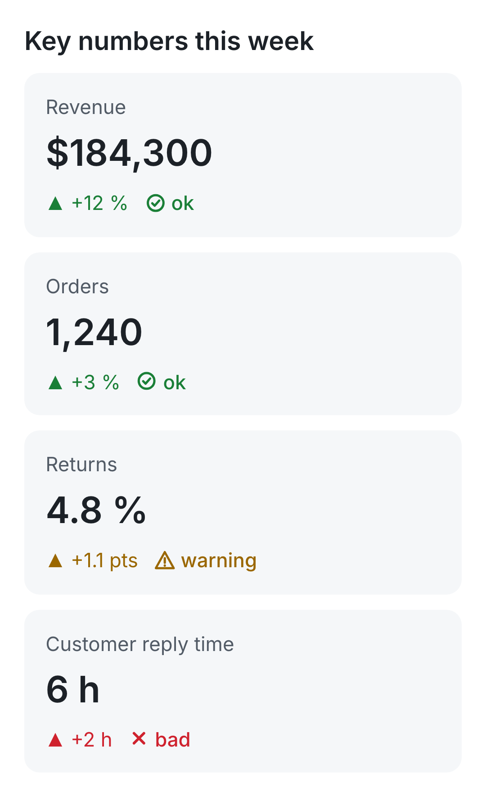

# VIS

**Gráficas y tarjetas que un modelo de lenguaje sabe escribir y que una persona puede leer en cualquier lado.**

[](https://github.com/HermannPR/vis/actions/workflows/ci.yml)
[](https://www.npmjs.com/package/@casiangel333/vis)
[](LICENSE)


[English](README.md)

VIS agrega unos cuantos bloques visuales a Markdown normal: gráficas, tarjetas de indicadores, avance, líneas de tiempo, comparaciones de antes y después, y formularios de decisión. Un agente los escribe como bloques de código cercados comunes. VIS los valida, le dice al agente exactamente cómo corregir cada error y los dibuja como HTML, SVG, PNG, texto plano o imágenes listas para WhatsApp.

````markdown
```kpi "Números clave de la semana"
- Ventas: $184,300 (+12 %, ok)
- Pedidos: 1,240 (+3 %, ok)
- Devoluciones: 4.8 % (+1.1 pts, alerta)
- Respuesta al cliente: 6 h (+2 h, mal)
```

```chart bar "Pedidos de la semana por canal" labels=true
canal,pedidos
Web,342
App,264
Tienda,236
Redes,193
Mayoreo,125
Teléfono,80
```
````

<picture>
  <source media="(prefers-color-scheme: dark)" srcset="docs/assets/hero-dark.png">
  
</picture>

## Por qué VIS

- **Pensado para que lo escriba un modelo.** Pocos tipos de bloque, una sola forma obvia de escribir cada uno, CSV para los datos y nada de ajustes de diseño. Todo el formato cabe en un [prompt de 500 tokens](docs/AGENT_PROMPT.md).
- **Errores que traen su arreglo.** Cada error tiene un código fijo, el bloque, la línea y una corrección sugerida, en un formato que el agente puede leer y aplicar. Casi siempre basta un reintento.
- **Se sigue leyendo como Markdown.** Un documento VIS es un documento CommonMark. En un visor que no conoce VIS, los bloques se ven como bloques de código ordenados.
- **Una fuente, muchas salidas.** HTML para la web, SVG, PNG del tamaño de un teléfono, texto plano para terminales y logs, y un paquete para WhatsApp con imágenes, pies de foto y encuestas.
- **Revisado, no solo dibujado.** `vis audit` dibuja en un navegador real, en claro y en oscuro, y reporta encimados, desbordes, contraste bajo y cifras de indicadores que no coinciden con la fuente.
- **Chico y completo.** Un solo archivo JavaScript sin dependencias en tiempo de ejecución. Las gráficas las dibuja Vega-Lite, que viene incluido en el paquete.

## Inicio rápido

Requiere Node.js 22 o más nuevo. PNG, `audit` y `whatsapp` también necesitan Chrome, Chromium o Brave.

```bash
npm install -g @casiangel333/vis
```

```bash
vis check reporte.md --lang es
```

```bash
vis render reporte.md --to html
```

O sin instalar:

```bash
npx @casiangel333/vis check reporte.md --lang es
```

## Bloques

| Tipo | Muestra |
|---|---|
| `chart` | Gráficas de barras, líneas, área, dispersión y dona a partir de CSV |
| `kpi` | Tarjetas de indicador con cambio y estado (`ok`, `alerta`, `mal`) |
| `progress` | Una barra de avance o una lista de tareas con porcentajes |
| `timeline` | Hitos con fecha y estado |
| `compare` | Tabla de antes y después con el mejor lado resaltado |
| `decisions` | Preguntas para una persona, con opciones y una respuesta recomendada |
| `sheet` | Una hoja de contactos de imágenes con pie |
| `mermaid`, `vega-lite`, `html` | Salidas de escape para diagramas, Vega-Lite directo y HTML de confianza |

Los tipos también aceptan nombres en español (`grafica`, `progreso`, `linea`, `comparar`, `decisiones`, `hoja`). La sintaxis completa, cada atributo y cada regla están en la [especificación del formato](docs/SPEC.md) (en inglés). Hay ejemplos en español en [examples/es/](examples/es/).

## Validación

`vis check` imprime un error por línea: `código|bloque|línea|mensaje|arreglo`. Con `--lang es`, el mensaje y el arreglo salen en español; los códigos son los mismos en los dos idiomas.

```text
$ vis check reporte.md --lang en
E_FIELD|chart#1|1|y=revnue is not in the header (month,revenue)|use y=revenue
E_LINE|kpi#2|8|in kpi the delta and status go in parentheses, not separated by pipes|write - Churn: 2.1 % (-0.3 pts, ok)
E_TYPE|timline#3|11|unknown block type "timline"|did you mean timeline?
```

Esas líneas se le regresan al agente para que las corrija. `--json` devuelve los mismos errores como objetos. El código de salida 0 significa válido y 1 significa que hay errores.

## Salidas

```bash
vis render reporte.md --to html          # una página independiente
vis render reporte.md --to svg           # la primera gráfica como SVG (--block N para otra)
vis render reporte.md --to png           # una imagen del ancho de un teléfono (390 px CSS)
vis render reporte.md --to text -o -     # texto plano a la salida estándar
vis audit reporte.md                     # revisión de diseño y contraste en claro y oscuro
vis whatsapp reporte.md -o out/          # un PNG por bloque más manifest.json
```

Opciones comunes: `--theme light|dark|auto`, `--width <px>`, `--lang en|es`, `--force` (dibuja aunque haya errores), `--strict` (sale con 2 cuando la auditoría encuentra problemas). `vis help <comando>` muestra el resto.

El texto plano conserva todas las cifras, así que no se pierde nada donde no se pueden mostrar imágenes:

```text
**Pedidos de la semana por canal**
Web       ████████████████████████ 342
App       ██████████████████▌      264
Tienda    ████████████████▌        236
Redes     █████████████▌           193
Mayoreo   ████████▊                125
Teléfono  █████▋                   80
```

### WhatsApp

`vis whatsapp` convierte un mensaje en partes listas para enviar: cada gráfica o tarjeta se vuelve un PNG de 1080 px que se lee sin abrirlo, con un pie de texto por si la imagen no llega; cada pregunta de `decisions` se vuelve un texto numerado y, cuando cabe, una encuesta; lo demás pasa al formato de WhatsApp. El envío lo haces tú. Ver [adapters/WHATSAPP.md](adapters/WHATSAPP.md) (en inglés).



## Usar VIS con un agente

1. Pon el [prompt para agentes](docs/AGENT_PROMPT.md) en tu prompt de sistema, en una skill o en la descripción de una herramienta. Funciona igual en español.
2. Corre `vis check --json` (o `check()`) sobre lo que escribe el agente.
3. Regrésale los errores: "Corrige estos errores de VIS y reenvía".
4. Dibuja para donde vaya la respuesta.

## API de JavaScript

```js
import { check, formatError, renderHTML, renderSVG, toText } from '@casiangel333/vis';
import { loadEngines } from '@casiangel333/vis/engines';

const engines = loadEngines();                       // { vega, vegaLite }, se cargan una vez
const result = check(markdown, { ...engines, lang: 'es' });
if (!result.ok) console.log(result.errors.map(formatError).join('\n'));

const { html, errors, alts } = await renderHTML(markdown, { ...engines, lang: 'es' });
const svg = await renderSVG(markdown, { ...engines, width: 640 });   // la primera gráfica como SVG
const text = toText(markdown, { lang: 'es' });
```

También funciona `require('@casiangel333/vis')`. En el navegador, carga `vis.js` con un `<script>` normal (después de Vega y Vega-Lite) y llama `vis.renderDocument(elemento, markdown)` para dibujar un documento en la página, o `vis.mount(elemento)` para convertir en dibujos los bloques VIS de una página ya renderizada. Otros puntos de entrada: `@casiangel333/vis/whatsapp` (planea las partes de WhatsApp sin dibujar) y `@casiangel333/vis/browser` (utilidades para Chrome sin interfaz).

## Integraciones

- **Chats web con CSP estricta.** [clients/web](clients/web) monta bloques VIS dentro de las burbujas de un chat con `script-src 'self'` y sin `unsafe-eval`: el DOM se arma con una lista cerrada de etiquetas y cada gráfica entra como imagen. Se construye con `npm run build:web`.
- **Claude Code.** [adapters/claude-widget-hook.mjs](adapters/claude-widget-hook.mjs) es un hook PreToolUse: cuando un agente manda Markdown con VIS a la herramienta de widgets del chat, lo valida, le regresa los errores al agente y, si pasa, pone el dibujo en su lugar.

## Idiomas

Los mensajes, arreglos y etiquetas existen en inglés y en español. La librería usa inglés por omisión. La línea de comandos sigue `--lang`, luego `VIS_LANG` y luego el idioma del sistema. El formato acepta palabras en español como alias (`alerta`, `mal`, `listo`, `en curso`, `pendiente`, `atrasado`, `bloqueado`, `@fecha`, `@texto`, `@rango`). Agregar un idioma es llenar una tabla en `vis.js`; ver [CONTRIBUTING.md](CONTRIBUTING.md#adding-a-locale).

## Mermaid

Los diagramas de Mermaid son opcionales y no vienen incluidos. Para dibujarlos, instala Mermaid junto a VIS (`npm install mermaid`) o apunta `VIS_MERMAID` a un archivo `mermaid.min.js`. Sin él, los bloques `mermaid` se muestran como código con una nota.

## Seguridad

VIS está hecho para dibujar texto que escribe un modelo, así que trata la entrada como no confiable por omisión: los bloques `html` se muestran como código salvo que pases `allowHTML` (`--allow-html`), las especificaciones de Vega-Lite y las rutas de imágenes no pueden apuntar a URLs remotas salvo que pases `allowRemoteData` (así una respuesta dibujada no puede filtrar datos con la petición de una imagen), y Mermaid corre con `securityLevel: 'strict'`. Para reportar una vulnerabilidad, ver [SECURITY.md](SECURITY.md).

## Comparación

| | VIS | GPT-Vis | json-render |
|---|---|---|---|
| Qué es | Un formato de respuesta para agentes | Gráficas para salida de LLM | Interfaz generativa a partir de un catálogo de componentes |
| Fuente | Bloques de Markdown con CSV o líneas | Bloques de Markdown con JSON o una sintaxis corta | JSON validado con Zod |
| Se lee antes de dibujar | Sí | En parte | No |
| Entrada inválida | Se rechaza con un arreglo que el modelo puede aplicar | Se tolera y se completa, para streaming | La rechaza el esquema |
| Salidas | HTML, SVG, PNG, texto, WhatsApp | Gráficas en el navegador | React, Vue, PDF, correo, imágenes, tarjetas de chat |
| Dependencias en ejecución | Ninguna | Librerías de AntV | Zod y un renderer por destino |

VIS no busca construir interfaces de apps. Úsalo cuando la respuesta de un agente tenga que leerse bien como texto y aun así llegar a un chat, una terminal, una imagen o WhatsApp.

## Contribuir

Reportes de errores, ejemplos e idiomas nuevos son muy bienvenidos. Empieza por [CONTRIBUTING.md](CONTRIBUTING.md) (en inglés); puedes abrir issues en español. Los cambios al formato pasan por una [propuesta de formato](https://github.com/HermannPR/vis/issues/new?template=format_proposal.yml). Todas las personas que participan siguen el [Código de conducta](CODE_OF_CONDUCT.md).

## Licencia

[MIT](LICENSE). VIS incluye Vega, Vega-Lite y la fuente Inter con sus propias licencias; ver [THIRD_PARTY_NOTICES.md](THIRD_PARTY_NOTICES.md). Las paletas de las gráficas se basan en ColorBrewer y Okabe-Ito.
