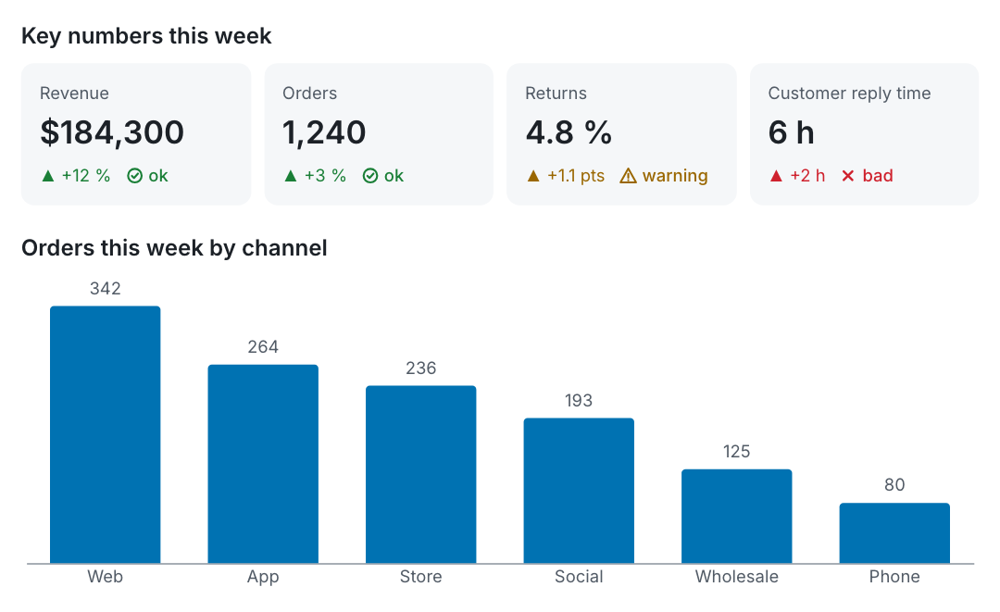
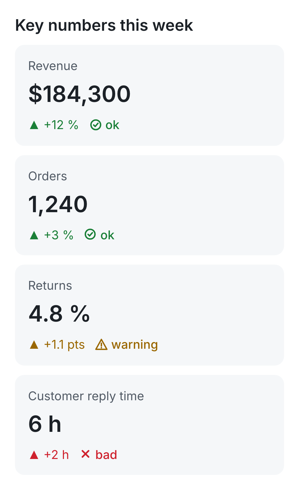

# VIS

**Charts and cards that language models can write, and humans can read anywhere.**

[](https://github.com/casiangel333/vis/actions/workflows/ci.yml)
[](https://www.npmjs.com/package/@casiangel333/vis)
[](LICENSE)


[Español](README.es.md)

VIS adds a few visual blocks to plain Markdown: charts, KPI cards, progress, timelines, before/after comparisons and decision forms. An agent writes them as ordinary fenced code blocks. VIS validates them, tells the agent exactly how to fix any mistake, and draws them as HTML, SVG, PNG, plain text or WhatsApp-ready images.

````markdown
```kpi "Key numbers this week"
- Revenue: $184,300 (+12 %, ok)
- Orders: 1,240 (+3 %, ok)
- Returns: 4.8 % (+1.1 pts, warn)
- Customer reply time: 6 h (+2 h, bad)
```

```chart bar "Orders this week by channel" labels=true
channel,orders
Web,342
App,264
Store,236
Social,193
Wholesale,125
Phone,80
```
````

<picture>
  <source media="(prefers-color-scheme: dark)" srcset="docs/assets/hero-dark.png">
  
</picture>

## Why VIS

- **Made for models to write.** Few block types, one obvious way to write each one, CSV for data, no layout knobs. The whole format fits in a [500-token prompt](docs/AGENT_PROMPT.md).
- **Errors that fix themselves.** Every error has a stable code, the block, the line and a suggested fix, in a format an agent can read and act on. One retry is almost always enough.
- **Still readable as Markdown.** A VIS document is a CommonMark document. In a viewer that knows nothing about VIS, the blocks read as tidy code blocks.
- **One source, many outputs.** HTML for the web, SVG, phone-sized PNG, plain text for terminals and logs, and a WhatsApp package with images, captions and polls.
- **Checked, not just drawn.** `vis audit` renders in a real browser, in light and dark, and reports overlaps, overflow, low contrast and KPI values that don't match the source.
- **Small and self-contained.** One JavaScript file with no runtime dependencies. Charts are drawn by Vega-Lite, which ships in the package.

## Quick start

Requires Node.js 22 or newer. PNG, `audit` and `whatsapp` also need Chrome, Chromium or Brave.

```bash
npm install -g @casiangel333/vis
```

```bash
vis check report.md
```

```bash
vis render report.md --to html
```

Or without installing:

```bash
npx @casiangel333/vis check report.md
```

## Blocks

| Type | Shows |
|---|---|
| `chart` | Bar, line, area, scatter and donut charts from CSV |
| `kpi` | Metric cards with delta and status (`ok`, `warn`, `bad`) |
| `progress` | A single progress bar or a checklist with percentages |
| `timeline` | Dated milestones with status |
| `compare` | Before/after table with the better side highlighted |
| `decisions` | Questions for a human, with options and a recommended answer |
| `sheet` | A contact sheet of images with captions |
| `mermaid`, `vega-lite`, `html` | Escape hatches for diagrams, raw Vega-Lite and trusted HTML |

The full syntax, every attribute and every rule is in the [format specification](docs/SPEC.md). More examples are in [examples/](examples/).

## Validation

`vis check` prints one error per line: `code|block|line|message|fix`.

```text
$ vis check report.md
E_FIELD|chart#1|1|y=revnue is not in the header (month,revenue)|use y=revenue
E_LINE|kpi#2|8|in kpi the delta and status go in parentheses, not separated by pipes|write - Churn: 2.1 % (-0.3 pts, ok)
E_TYPE|timline#3|11|unknown block type "timline"|did you mean timeline?
```

Hand those lines back to the agent and ask it to fix them. `--json` returns the same errors as objects. Exit code 0 means valid, 1 means errors.

## Outputs

```bash
vis render report.md --to html          # a standalone page
vis render report.md --to svg           # the first chart as SVG (--block N for another)
vis render report.md --to png           # a phone-sized image (390 CSS px wide)
vis render report.md --to text -o -     # plain text to stdout
vis audit report.md                     # layout and contrast check in light and dark
vis whatsapp report.md -o out/          # one PNG per block plus manifest.json
```

Common options: `--theme light|dark|auto`, `--width <px>`, `--lang en|es`, `--force` (render even with errors), `--strict` (exit 2 when the audit finds problems). Run `vis help <command>` for the rest.

Plain text keeps every number, so nothing is lost where images can't be shown:

```text
**Orders this week by channel**
Web        ████████████████████████ 342
App        ██████████████████▌      264
Store      ████████████████▌        236
Social     █████████████▌           193
Wholesale  ████████▊                125
Phone      █████▋                   80
```

### WhatsApp

`vis whatsapp` turns a message into parts ready to send: each chart or card becomes a 1080 px PNG sized to read without opening it, with a text caption as fallback; each `decisions` question becomes a numbered text and, when it fits, a poll; the rest becomes WhatsApp formatting. Sending is up to you. See [adapters/WHATSAPP.md](adapters/WHATSAPP.md).



## Using VIS with an agent

1. Put the [agent prompt](docs/AGENT_PROMPT.md) in your system prompt, a skill or a tool description.
2. Run `vis check --json` (or `check()`) on what the agent writes.
3. Send any errors back: "Fix these VIS errors and resend".
4. Render for wherever the answer is going.

## JavaScript API

```js
import { check, formatError, renderHTML, renderSVG, toText } from '@casiangel333/vis';
import { loadEngines } from '@casiangel333/vis/engines';

const engines = loadEngines();                       // { vega, vegaLite }, loaded once
const result = check(markdown, { ...engines, lang: 'en' });
if (!result.ok) console.log(result.errors.map(formatError).join('\n'));

const { html, errors, alts } = await renderHTML(markdown, engines);  // HTML fragment plus chart alt texts
const svg = await renderSVG(markdown, { ...engines, width: 640 });   // the first chart as standalone SVG
const text = toText(markdown);
```

`require('@casiangel333/vis')` works too. In the browser, load `vis.js` with a plain `<script>` (after Vega and Vega-Lite) and call `vis.renderDocument(element, markdown)` to draw a document into a page, or `vis.mount(element)` to turn the VIS code blocks of an already rendered page into drawings. Other entry points: `@casiangel333/vis/whatsapp` (planning the WhatsApp parts without drawing) and `@casiangel333/vis/browser` (headless Chrome helpers).

## Integrations

- **Web chats with a strict CSP.** [clients/web](clients/web) mounts VIS blocks into chat bubbles under `script-src 'self'` with no `unsafe-eval`: the DOM is built from a closed list of tags and every chart goes in as an image. Build it with `npm run build:web`.
- **Claude Code.** [adapters/claude-widget-hook.mjs](adapters/claude-widget-hook.mjs) is a PreToolUse hook: when an agent sends VIS Markdown to the chat widget tool, it validates it, sends errors back to the agent, and swaps in the drawing when it passes.

## Languages

Messages, fixes and labels are available in English and Spanish. The library defaults to English. The CLI follows `--lang`, then `VIS_LANG`, then the system locale. The format accepts Spanish keywords as aliases (`alerta`, `listo`, `en curso`, `@fecha`, ...). New languages are a table in `vis.js`; see [CONTRIBUTING.md](CONTRIBUTING.md#adding-a-locale).

## Mermaid

Mermaid diagrams are optional and not bundled. To draw them, install Mermaid next to VIS (`npm install mermaid`) or point `VIS_MERMAID` at a `mermaid.min.js` file. Without it, `mermaid` blocks render as code with a note.

## Security

VIS is meant to render text written by a model, so it treats input as untrusted by default: `html` blocks render as code unless you pass `allowHTML` (`--allow-html`), Vega-Lite specs and image paths can't point to remote URLs unless you pass `allowRemoteData` (so a rendered answer can't leak data through an image request), and Mermaid runs with `securityLevel: 'strict'`. See [SECURITY.md](SECURITY.md) to report a vulnerability.

## How it compares

| | VIS | GPT-Vis | json-render |
|---|---|---|---|
| What it is | A response format for agents | Charts for LLM output | Generative UI from a component catalog |
| Source | Markdown fences with CSV or lines | Markdown fences with JSON or a short syntax | JSON validated with Zod |
| Readable before rendering | Yes | Partly | No |
| Invalid input | Rejected with a fix the model can apply | Tolerated and completed, for streaming | Rejected by the schema |
| Outputs | HTML, SVG, PNG, text, WhatsApp | Browser charts | React, Vue, PDF, email, images, chat cards |
| Runtime dependencies | None | AntV libraries | Zod and a renderer per target |

VIS doesn't try to build app UIs. Pick it when an agent's answer has to read well as text and still reach a chat, a terminal, an image or WhatsApp.

## Contributing

Bug reports, examples and new languages are very welcome. Start with [CONTRIBUTING.md](CONTRIBUTING.md). Changes to the format itself go through a [format proposal](https://github.com/casiangel333/vis/issues/new?template=format_proposal.yml). Everyone taking part follows the [Code of Conduct](CODE_OF_CONDUCT.md).

## License

[MIT](LICENSE). VIS ships Vega, Vega-Lite and the Inter font under their own licenses; see [THIRD_PARTY_NOTICES.md](THIRD_PARTY_NOTICES.md). Chart palettes are based on ColorBrewer and Okabe-Ito.
